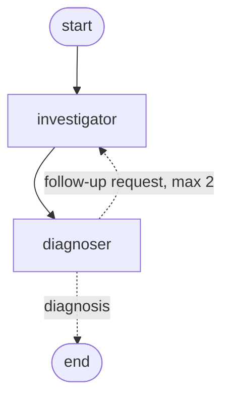

# ml-debug-agent

[](https://github.com/miandfetter/ml-debug-agent/actions/workflows/ci.yml)

LLM agents that diagnose what went wrong in a machine learning training run, using only
what an engineer would see in the experiment tracker: the logged config, per-epoch
metrics, and the train/validation split.

The project builds a labeled benchmark of deliberately broken training runs, then
compares three diagnosers on it: a hand-written rule baseline, a single tool-using agent,
and a two-agent LangGraph system in which a diagnoser can ask an investigator for more
evidence.

**Stack:** PyTorch · MLflow · LangChain · LangGraph · Pydantic · Ollama / Gemini / Amazon Bedrock ·
Docker · AWS (S3, ECR, ECS Fargate, IAM) · Terraform · GitHub Actions · pytest · uv

## How it works

```
 train.py ──► MLflow ──► mlflow_access.py ──► tools.py ──► agent ──► Diagnosis ──► eval harness
 (inject a    (runs,     (the only code that  (measurements,  (single or       (validated   (accuracy,
  known bug)   metrics)   reads MLflow; hides  no conclusions)  two-agent)       Pydantic     confusion
                          the answer)                                            model)       matrix)
```

### 1. A benchmark with known answers

A small MLP is trained on Fashion-MNIST (10 classes). Each bug is a set of config changes
from a healthy run:

| Bug | What is changed |
|---|---|
| `none` | nothing (healthy control) |
| `lr_too_high` | learning rate 0.5, about 500x normal |
| `overfit` | 500 training examples, no dropout or weight decay, 30 epochs |
| `label_shuffle` | training labels randomly permuted |
| `leakage` | the validation set copied into the training set |
| `unnormalized` | raw 0-255 pixels instead of normalized inputs |

`benchmark-v1` contains **30 runs: 6 bug types x 5 seeds**, with small variations in the
healthy settings so runs of the same bug don't look identical. Every run logs its config,
per-epoch losses, accuracies and gradient norms, and its split indices to MLflow.

### 2. Keeping the answer hidden

The true bug is stored in each run's name, description and an `eval.true_bug` tag.
[`mlflow_access.py`](src/ml_debug_agent/agents/mlflow_access.py) is the only module that
reads MLflow. Agents see runs through `get_run_view()`, which uses an **allowlist** of
fields, so the parameters that *are* the bug (`label_noise`, `leak_val_into_train`) are
never exposed. Only the eval harness may call `get_true_bug()`.

### 3. Tools

[`tools.py`](src/ml_debug_agent/agents/tools.py) gives the agents four tools:
`summarize_curves`, `get_config`, `check_split_overlap` and `get_metric_history`.
Code does the arithmetic, since LLMs are unreliable at maths over long lists of numbers,
and the run ID is fixed in code, so the model can't mistype it or inspect other runs.
Tools return **measurements, never conclusions**.

### 4. A fair comparison

Prompts and tool descriptions define what each label means, but never describe symptoms
or thresholds. Otherwise the agent would just be the baseline's rules written in English.
A test scans every prompt and tool description for give-away terms.

### 5. The diagnosers

- **Rule baseline** ([`baseline.py`](src/ml_debug_agent/eval/baseline.py)): hand-written
  if-statements over the same tool outputs.
- **Single agent** ([`single_agent.py`](src/ml_debug_agent/agents/single_agent.py)): a
  tool-calling agent gathers evidence, then a second call reads only the raw tool outputs
  and returns a structured `Diagnosis`.
- **Two agents** ([`graph.py`](src/ml_debug_agent/agents/graph.py)): a LangGraph state
  machine.



The **investigator** has tools but never interprets. Code copies its tool outputs into an
`EvidenceReport`, and fills in any required tool it skipped. The **diagnoser** has no
tools. It reasons in plain text and ends with either `Final answer: <label>` or
`Need more evidence: <request>`. On its last allowed turn it is told it must commit.
Keeping the two roles separate makes each failure traceable: was the evidence missing,
or was it misread?

### 6. Evaluation

[`run_benchmark.py`](src/ml_debug_agent/eval/run_benchmark.py) runs any diagnoser over
the benchmark and reports accuracy, accuracy per bug, false-positive rate (healthy runs
flagged as buggy) and a confusion matrix. A failed run is recorded as `error` rather than
stopping the eval.

### 7. Running in the cloud

- **Artifacts in S3.** MLflow keeps run metadata (params, metrics, tags) in a local SQLite
  database and run files in an artifact store. Setting `MLFLOW_ARTIFACT_ROOT` makes new
  experiments store their files in a private, encrypted S3 bucket. `benchmark-v2` is the
  same 30 runs as v1 with its artifacts in S3; the agents' tools read them through MLflow
  with no code changes.
- **A slim evaluation image.** The [Dockerfile](Dockerfile) builds an image that runs the
  eval harness. Bug and config definitions live in a PyTorch-free module
  ([`config.py`](src/ml_debug_agent/training/config.py)) and PyTorch is an optional
  dependency group, so the image doesn't include it. A multi-stage build ships only the
  finished Python environment.
- **ECR.** The image is stored in a private Amazon ECR repository with vulnerability
  scanning on push and a rule that keeps only the 5 newest images.
- **Amazon Bedrock** is a third model provider (Amazon Nova 2 Lite by default). It's
  implemented and unit-tested; end-to-end runs are waiting on a Bedrock quota for the new
  AWS account.
- **ECS Fargate.** The evaluation runs as an on-demand Fargate task with least-privilege
  IAM roles and logs in CloudWatch. A full baseline run takes about a minute, end to end.
- **Infrastructure as code.** Every AWS resource is defined in
  [Terraform](infra/terraform/). They were first created by hand with the CLI, then
  imported into Terraform without recreating anything.
- **CI/CD.** GitHub Actions runs lint, the tests and Terraform checks on every push and
  pull request. After they pass on `main`, it builds the ARM64 image and pushes it to ECR,
  authenticating to AWS with OIDC instead of stored keys.
- **Credentials:** AWS IAM Identity Center (SSO) locally, IAM roles on Fargate, and OIDC
  in GitHub Actions. No long-lived AWS access keys anywhere.

## Results

### Headline: Gemini 3.7 Flash on `benchmark-v2` (30 runs)

| Diagnoser | Correct | Accuracy | False positives (healthy runs flagged) | Mean time per run |
|---|---|---|---|---|
| **Two agents** (LangGraph) | **29 / 30** | **96.7%** | 0 of 5 | 16.5 s |
| Single agent | 28 / 30 | 93.3% | 0 of 5 | 14.9 s |

By bug type:

| | none | lr_too_high | overfit | label_shuffle | leakage | unnormalized |
|---|---|---|---|---|---|---|
| Two agents | 5/5 | 5/5 | **4/5** | 5/5 | 5/5 | 5/5 |
| Single agent | 5/5 | 5/5 | **3/5** | 5/5 | 5/5 | 5/5 |

Every miss was an `overfit` run diagnosed as healthy. Both systems missed the same run:
it has the overfit configuration (500 training examples, no regularization) but hadn't
started overfitting yet. Its validation loss was still falling at the last epoch, and its
train/validation accuracy gap was half that of the other overfit runs. The label
describes the setup, not what the curves show. The single agent's second miss had only a
slight rise in validation loss.

With 5 runs per bug type, a one-run difference is within noise: on this model the two
designs perform about the same.

### Earlier results, by model

| Diagnoser | Model | Benchmark | Runs | Correct |
|---|---|---|---|---|
| Rule baseline | none | v1 | 30 | 30 / 30 |
| Rule baseline, in Docker | none | v2 (artifacts in S3) | 30 | 30 / 30 |
| Single agent | gemma4:e2b (2B, local) | v1 | 30 | 5 / 30 (predicted `none` every time) |
| Single agent | qwen3.5:9b (local) | v1 | 30 | 20 / 30 |
| Two agents | qwen3.5:9b (local) | v1 | 6 (1 per bug) | 5 / 6 |

Single agent with qwen3.5:9b, by bug:

| none | lr_too_high | overfit | label_shuffle | leakage | unnormalized |
|---|---|---|---|---|---|
| 5/5 | 4/5 | 4/5 | **0/5** | 5/5 | 2/5 |

The prompts and tool descriptions changed between some of the earlier runs, so treat
those comparisons as indicative.

### What I learned

- **The two-agent structure helps most when the model is weaker.** On qwen3.5:9b, the
  single agent got `label_shuffle` 0/5, and the two-agent diagnoser's free-text reasoning
  step (comparing the loss with chance level) fixed it. On Gemini 3.7 Flash, both designs
  get every `label_shuffle` run right and score within one run of each other.
- **Confidence scores aren't calibrated.** The two-agent system's one wrong answer came
  with confidence 1.0.
- **The rule baseline scores 100% because its author designed the bugs.** Its thresholds
  are tuned to this benchmark. The agents get no thresholds, so they are tested on
  reasoning from evidence, which is what matters for bugs nobody wrote a rule for. A
  natural next step is adding bug types the baseline has no rule for.
- **Structured output on Ollama hid the schema from the model.** Ollama enforces a JSON
  schema while generating text but never shows it to the model, so the `Diagnosis` field
  descriptions (and the "write evidence before choosing a label" design) were silently
  ignored, and the 2B model answered `none` for everything. Describing the schema in the
  prompt fixed this.
- **`label_shuffle` is hard because its only symptom is an absence.** Training loss stays
  at ln(10) ≈ 2.30, the loss of random guessing over 10 classes, and accuracy at ~10%.
  Nothing diverges and there is no train/validation gap, so a model scanning for warning
  signs finds none, and the noisy validation loss looks like overfitting. The single agent
  got 0/5. In the two-agent system, the diagnoser's free-text reasoning compared the loss
  with chance level and got it right.
- **A hint was hiding in a tool description** ("a nonzero overlap means leakage"). It was
  removed, and the fairness test now covers tool descriptions as well as prompts.
- **The first Docker image was 3.66 GB.** uv's download cache had been baked into a layer,
  and a `chown -R` stored a second copy of every installed file. A build cache mount, no
  recursive `chown`, and a multi-stage build brought it to 1.41 GB (310 MB compressed in
  ECR). Most of the rest is full MLflow's extras.
- **Docker Desktop pushes an index plus a build attestation by default.** The extra
  untagged entries count against ECR's cleanup rule, and ECR's basic scanning doesn't scan
  an index. Building with `--provenance=false` pushes a single plain image.
- **Importing hand-built AWS resources into Terraform.** `import` blocks adopted all 15
  resources into Terraform's state without recreating anything. The first plan showed
  `15 to import, 0 to add, 9 to change, 0 to destroy`; the 9 changes were tags plus an
  equivalent rewrite of one IAM policy. Building the bucket ARN from its name, rather than
  from the bucket resource, kept that policy readable in the plan instead of
  "known after apply".
- **GitHub Actions couldn't assume the AWS role: the OIDC subject format had changed.**
  The workflow log only said "Not authorized to perform sts:AssumeRoleWithWebIdentity".
  CloudTrail recorded the token's actual subject,
  `repo:<owner>@<owner-id>/<repo>@<repo-id>:ref:refs/heads/main`: the repository uses
  GitHub's immutable subject format, which adds permanent numeric IDs so a deleted and
  recreated repository with the same name can't match. The role was trusting the old
  `repo:<owner>/<repo>:...` form. The fix was to trust the new format rather than turn it
  off.
- **On Linux, PyTorch pulls in several GB of NVIDIA GPU libraries by default.** CI would
  download them on every run for tests that never use a GPU. A uv index source installs
  the CPU-only build on Linux, while macOS keeps the normal build.
- **Not every GitHub Action publishes a major-version tag.** `astral-sh/setup-uv@v10`
  failed before any step ran because the action only publishes full versions like
  `v10.3.0`. `actionlint` checks a workflow's syntax but not whether each version exists.
- **A new AWS account had Bedrock quotas of 0 for every model.** Comparing the applied
  quotas with AWS's defaults (`list-aws-default-service-quotas`) showed the limits were
  account overrides rather than a code problem.

## Running it

### Requirements

- Python 3.12+ and [uv](https://docs.astral.sh/uv/)
- [Ollama](https://ollama.com/) for local models, or a Gemini API key
- About 7 GB of disk space for `qwen3.5:9b`; 16 GB of RAM is enough to run it
- For the cloud parts (optional): [Docker](https://www.docker.com/) and AWS CLI v2 with an
  SSO profile (`aws configure sso`)

### Setup

```bash
uv sync
ollama pull qwen3.5:9b
```

`uv sync` installs everything, including PyTorch (the `train` group) and the dev tools.

Settings go in a `.env` file in the project root (it is gitignored). For example:

```bash
LLM_PROVIDER=ollama
OLLAMA_MODEL=qwen3.5:9b
BENCHMARK_EXPERIMENT=benchmark-v2
AWS_PROFILE=ml-debug
MLFLOW_ARTIFACT_ROOT=s3://<your-bucket>/mlflow
```

| Setting | What it does | Default |
|---|---|---|
| `LLM_PROVIDER` | `ollama`, `gemini` or `bedrock` | `ollama` |
| `OLLAMA_MODEL` / `GEMINI_MODEL` / `BEDROCK_MODEL` | Model for that provider | `gemma4:e2b` / `gemini-2.5-flash` / `us.amazon.nova-2-lite-v1:0` |
| `BEDROCK_REGION` | Region for Bedrock calls | `us-east-1` |
| `BENCHMARK_EXPERIMENT` | Benchmark that commands use when none is named | `benchmark-v1` |
| `AWS_PROFILE` | AWS CLI profile for S3 and Bedrock | none |
| `MLFLOW_ARTIFACT_ROOT` | Where *new* experiments store run files, e.g. an S3 path | MLflow's local `mlruns/` |

Gemini also needs `GEMINI_API_KEY` in your environment. AWS access uses your SSO login
(`aws sso login`), never access keys.

### Generate the benchmark

Downloads Fashion-MNIST to `data/` and trains 30 runs into an MLflow experiment. It is
safe to re-run: existing runs are skipped.

```bash
uv run python scripts/generate_benchmark.py --experiment benchmark-v2
```

If `MLFLOW_ARTIFACT_ROOT` is set when the experiment is first created, its artifacts go to
`<root>/<experiment>` (for example in S3). MLflow fixes this when the experiment is
created, so set it beforehand. To browse the runs at http://localhost:5000:

```bash
uv run mlflow ui
```

To train a single run with a specific bug:

```bash
uv run python -m ml_debug_agent.training.train --bug overfit --seed 1
```

### Evaluate a diagnoser

The full benchmark:

```bash
uv run python -m ml_debug_agent.eval.run_benchmark --system baseline
uv run python -m ml_debug_agent.eval.run_benchmark --system single_agent
uv run python -m ml_debug_agent.eval.run_benchmark --system two_agent
```

Quicker subsets: one run of each bug type (about 20 minutes for `two_agent` on a laptop),
or only some bug types:

```bash
uv run python -m ml_debug_agent.eval.run_benchmark --system two_agent --per-bug 1
uv run python -m ml_debug_agent.eval.run_benchmark --system two_agent --bugs label_shuffle lr_too_high
```

Systems: `baseline`, `single_agent`, `single_agent_thinking`, `two_agent`. Use
`--experiment` to pick a benchmark other than the default. Per-run results (prediction,
evidence, confidence, time, errors) are saved to
`results/<experiment>/<system>[_per_bugN][_bugs].csv`.

### Inspect one diagnosis

The full two-agent trace (tools called, the diagnoser's reasoning on each turn, any
follow-up findings) for the benchmark's first run, or for a given run:

```bash
uv run python -m ml_debug_agent.agents.graph
uv run python -m ml_debug_agent.agents.graph <run_id>
uv run python -m ml_debug_agent.agents.single_agent <run_id>
```

Exactly what the agents are allowed to see for a run:

```bash
uv run python -m ml_debug_agent.agents.mlflow_access <run_id>
```

### Tests

```bash
uv run pytest
```

The tests use scripted fake models, so they need no LLM, and train tiny stand-in runs in a
throwaway MLflow store. They need no AWS access either: they never write to S3 and only
construct (never call) the Bedrock client. They cover the tools, the eval harness, the
agents' plumbing, the two-agent routing and follow-up cap, the model providers, the
artifact-location logic, the cloud entrypoint and launcher, and the no-give-away rule for
prompts and tool descriptions. CI runs them on every push (see "CI/CD" below).

### Docker

Build the evaluation image (it runs `run_benchmark`; PyTorch is not included):

```bash
docker build --provenance=false -t ml-debug-agent .
```

Run the rule baseline in the container against `benchmark-v2`. This mounts your
`mlflow.db` read-only, shares the `results/` folder, and passes short-lived credentials
from your SSO login as environment variables (nothing is written to disk or baked into the
image):

```bash
docker run --rm \
  -v "$PWD/mlflow.db:/app/mlflow.db:ro" \
  -v "$PWD/results:/app/results" \
  --env-file <(aws configure export-credentials --profile ml-debug --format env-no-export) \
  -e AWS_REGION=us-east-1 \
  -e BENCHMARK_EXPERIMENT=benchmark-v2 \
  ml-debug-agent --system baseline
```

Arguments after the image name replace the default `--system baseline`. The container
can't reach Ollama on your machine, so the agent systems need `-e LLM_PROVIDER=bedrock`
(or `gemini`).

### Push the image to ECR

The repository itself (private, scanned on push, keeps the 5 newest images) is defined in
Terraform, in [`ecr.tf`](infra/terraform/ecr.tf); see "AWS infrastructure (Terraform)"
below.

**Merges to `main` push the image automatically** (see "CI/CD" below), so the manual
routine is only needed to try out an image before committing. Replace `<account-id>` with your AWS account ID
(`aws sts get-caller-identity --query Account --output text`).

1. Build the image:

   ```bash
   docker build --provenance=false -t ml-debug-agent .
   ```

2. Log Docker in to ECR (the password comes from your SSO login and lasts 12 hours):

   ```bash
   aws ecr get-login-password | docker login --username AWS --password-stdin <account-id>.dkr.ecr.us-east-1.amazonaws.com
   ```

3. Tag the image with its ECR address:

   ```bash
   docker tag ml-debug-agent:latest <account-id>.dkr.ecr.us-east-1.amazonaws.com/ml-debug-agent:latest
   ```

4. Push it (only changed layers are uploaded):

   ```bash
   docker push <account-id>.dkr.ecr.us-east-1.amazonaws.com/ml-debug-agent:latest
   ```

Check what's in the repository, and the vulnerability scan results:

```bash
aws ecr describe-images --repository-name ml-debug-agent --query "imageDetails[].[imageTags[0],imageSizeInBytes,imageScanStatus.status]" --output table
```

```bash
aws ecr describe-image-scan-findings --repository-name ml-debug-agent --image-id imageTag=latest --query "imageScanFindings.findingSeverityCounts"
```

### Run the evaluation on AWS Fargate

The image runs as an on-demand ECS Fargate task (ARM64). On startup it downloads
`mlflow.db` from S3, runs the benchmark, uploads the results CSV to S3 and exits, so
nothing keeps running or billing between runs. One command starts a task, waits for it,
and prints its logs and where the results landed:

```bash
uv run python scripts/run_cloud_eval.py
```

Arguments the script doesn't use itself are passed to the container. For example, one run
of each bug type, or an agent system:

```bash
uv run python scripts/run_cloud_eval.py --system baseline --per-bug 1
uv run python scripts/run_cloud_eval.py --system two_agent --bugs label_shuffle
```

Its own options: `--upload-db` uploads your local `mlflow.db` to S3 first (the cloud only
sees runs that existed at the last upload), and `--no-wait` starts the task and exits.
Results are saved under `s3://<your-bucket>/results/<UTC timestamp>/<experiment>/`.

Tasks run in public subnets with a public IP, which avoids a NAT gateway (billed hourly
even when idle). The task role can only read the benchmark, write under `results/`, and
call one Bedrock model; it can't delete or overwrite anything.

### AWS infrastructure (Terraform)

Every AWS resource the project uses is defined in [`infra/terraform/`](infra/terraform/):

| Resource | Name | Defined in |
|---|---|---|
| S3 bucket (`mlflow/` artifacts, `state/mlflow.db`, `results/`): private, encrypted, protected from deletion | `ml-debug-artifacts-<account-id>` | [`s3.tf`](infra/terraform/s3.tf) |
| ECR repository (scan on push, keeps the 5 newest images) | `ml-debug-agent` | [`ecr.tf`](infra/terraform/ecr.tf) |
| IAM execution role (pull the image, write logs) | `ml-debug-ecs-execution-role` | [`iam.tf`](infra/terraform/iam.tf) |
| IAM task role (the code: read benchmark, write results, call one Bedrock model) | `ml-debug-ecs-task-role` | [`iam.tf`](infra/terraform/iam.tf) |
| CloudWatch log group, 14-day retention | `/ecs/ml-debug-agent` | [`ecs.tf`](infra/terraform/ecs.tf) |
| ECS cluster and task definition (1 vCPU, 2 GB, ARM64) | `ml-debug`, `ml-debug-agent-eval` | [`ecs.tf`](infra/terraform/ecs.tf) |
| Security group (no inbound, all outbound) in the default VPC | `ml-debug-eval-task` | [`network.tf`](infra/terraform/network.tf) |
| GitHub OIDC provider, and a role only this repository's `main` branch can assume (push to the ECR repository, nothing else) | `ml-debug-github-actions-ecr-push` | [`github.tf`](infra/terraform/github.tf) |

Settings you might change (image tag, default benchmark, Bedrock model, log retention)
are variables in [`variables.tf`](infra/terraform/variables.tf). Every resource is
tagged `Project=ml-debug-agent` and `ManagedBy=terraform`.

Run Terraform from its folder, with your AWS profile active:

```bash
cd infra/terraform
terraform init
```

`init` downloads the AWS provider once. To change infrastructure, edit the `.tf` files,
review the dry run, then apply it (it asks you to type `yes`):

```bash
terraform plan
terraform apply
```

After applying, `terraform plan` should report `No changes`. If it shows changes you
didn't make in code, something was edited by hand in AWS ("drift"). To print the values
other commands need, such as the ECR URL and the bucket name:

```bash
terraform output
```

The state file (`terraform.tfstate`) stays local and is gitignored; the provider lock
file (`.terraform.lock.hcl`) is committed so everyone uses the same provider version.
`terraform destroy` would remove everything except the bucket, which is protected by
`prevent_destroy`.

### CI/CD (GitHub Actions)

[`.github/workflows/ci.yml`](.github/workflows/ci.yml) runs on every push to `main` and
every pull request:

```
git push
  │
  ├─ Lint and test ─────────────┐   ruff, then pytest (no AWS access needed)
  │                              ├─► both pass, on a push to main?
  └─ Terraform fmt + validate ──┘         │
                                          ▼
                              Build and push image
                              ARM64 runner → OIDC → ECR
                              tags: <commit SHA> and latest
```

- **CI:** two read-only jobs in parallel. The tests use fake models and fake AWS
  clients, and on Linux PyTorch installs as its CPU-only build, so a run takes under a
  minute.
- **CD:** runs only after both checks pass, and only for pushes to `main`. It builds on
  GitHub's ARM64 runner (the same architecture as the Fargate task), caches layers
  between runs, and tags each image with the commit that built it as well as `latest`,
  which the task definition runs.
- **No AWS keys in GitHub.** The deploy job requests a signed OIDC token from GitHub, and
  AWS exchanges it for 1-hour credentials for one role. That role trusts only this
  repository's `main` branch, identified by its permanent numeric IDs, and can only push
  to the ECR repository: it can't delete images, read the bucket or run tasks. The role
  ARN comes from the repository variable `AWS_ROLE_ARN`
  (`gh variable set AWS_ROLE_ARN --body "<terraform output github_actions_role_arn>"`).
- **`terraform apply` stays manual**, after reviewing the plan. Automating it would mean
  giving CI broad AWS permissions.

To follow a run after pushing:

```bash
gh run watch
```

Or open the repository's **Actions** tab. For the output of a failed step:

```bash
gh run view <run-id> --log-failed
```

## Project layout

```
scripts/generate_benchmark.py   build the labeled benchmark
scripts/run_cloud_eval.py       run the evaluation on Fargate with one command
src/ml_debug_agent/
  training/config.py            bug types and training configs (no PyTorch)
  training/train.py             MLP training with injectable bugs, logged to MLflow
  agents/mlflow_access.py       the only MLflow reader; hides the answer
  agents/tools.py               LangChain tools over a run
  agents/schemas.py             Pydantic models for every LLM output
  agents/llm.py                 chooses Ollama, Gemini or Bedrock from .env
  agents/single_agent.py        single tool-using agent
  agents/graph.py               two-agent LangGraph system
  eval/baseline.py              rule-based baseline
  eval/run_benchmark.py         evaluation harness
  eval/cloud_run.py             container entrypoint: S3 download, eval, S3 upload
tests/                          pytest suite
Dockerfile, .dockerignore       the evaluation image
infra/terraform/                all AWS infrastructure, as Terraform
.github/workflows/ci.yml        CI (lint, tests, Terraform checks) and CD (push to ECR)
```

## Next steps

- Run the agents on Amazon Bedrock once the account's quota is available
- Keep the Terraform state in S3 with locking, the standard setup for a team
- Pin GitHub Actions to commit SHAs, with Dependabot to keep them up to date
- Add bug types the rule baseline has no rule for, to test generalization
- Shrink the image further by using `mlflow-skinny`

## License

MIT
